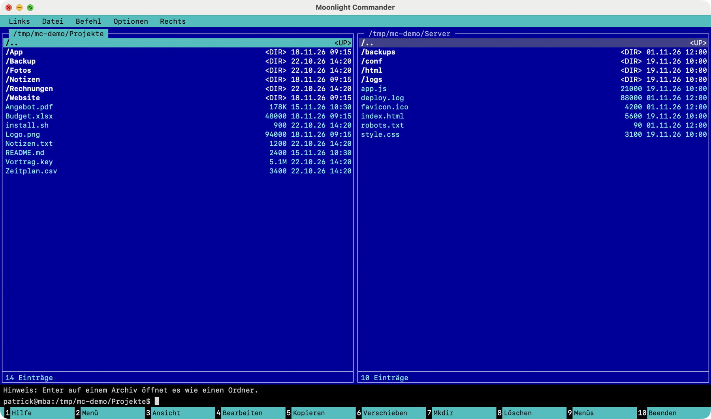
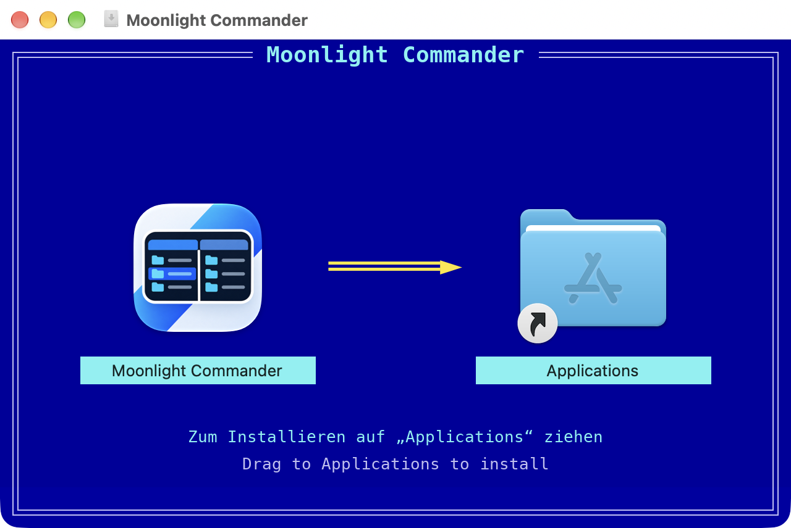

# Moonlight Commander

[Deutsche Fassung](README.md)

Native Norton Commander clone for macOS (AppKit). Two panels, fast file operations, SFTP, FTP/FTPS, SMB shares, a direct connection between two Macs and an mcedit-style editor.

[Download 1.6.15 (DMG, signed and notarized)](https://github.com/patrickdoern/mc/releases/latest) · [Website](https://moonlight-commander.org/en/)



Installation: open the DMG and drag "Moonlight Commander" to "Applications".



```bash
./scripts/bundle.sh
open "build/Moonlight Commander.app" --args ~/Downloads ~/projects
```

Building: `./scripts/build-libssh2.sh` builds OpenSSL and libssh2 once as static libraries into `vendor/` (only Xcode and a network connection are needed). `./scripts/bundle.sh` creates `build/Moonlight Commander.app`, `./scripts/install.sh` installs it to `/Applications/Moonlight Commander.app`. The app is a single file without Homebrew and runs on Apple Silicon from macOS 14. Without `vendor/`, `swift build` falls back to `brew install libssh2`. Tests: `swift test`; with the environment variable `MC_SSH_CONFIG=<file>` the app reads SSH aliases, keys and `known_hosts` only from that configuration instead of `~/.ssh` (for safe tests against local servers); the SFTP tests only run with `MC_TEST_SSH_DIR` (a folder containing `clientkey`, sshd on 127.0.0.1:2222).

## Command line

`./scripts/install.sh` puts `mc` and `mcedit` into `~/.local/bin` (an existing `mcedit` that does not come from Moonlight Commander is left alone); their messages appear in the system language (German or English):

```bash
mc                    # open the current folder in the active panel
mc folder1 folder2    # set the left and right panel
mcedit file.txt       # open a file directly in the editor (new files are created)
```

Both also work while the app is running. Folders can also be dragged onto the Dock icon.

**Finder:** Text files can be opened in the editor via right-click → "Open With" → Moonlight Commander (the app is registered only as an alternative and does not replace any default). Via Get Info → "Open With" it can be set as the default for a file type. Folders dragged onto the Dock icon open in the active panel.

## Keys

| Key | Action |
|---|---|
| Tab | switch panel |
| Enter / Backspace | open / go up one level |
| Space, Ins, ⇧↑↓ | mark; `+` `-` pattern, `*` invert |
| Ctrl-S | quick search |
| ⌘L / ⇧⌘H / ⌘K | path / home / connect via SFTP, FTP or SMB |
| ⌘← / ⌘→ | directory history back / forward (per panel, the history list is under "History …" in the Left/Right menu) |
| F2 | user menu (entries from `~/.config/moonlight-commander/menu`, mc format, macros `%f %d %s %D %F`) |
| F3 / F4 | view / edit (⇧F4 new file), both with syntax highlighting |
| F5 / F6 | copy (⇧F5 pack into archive) / move (⇧F6 rename) |
| F7 / F8 | make folder / delete (local: Trash, ⇧F8 permanent) |
| F9 / F10 | menu bar (Left, File, Command, Options, Right) / quit; `exit` on the command line also quits |
| Typing | writes to the command line; Tab completes commands and file names, Enter runs in the terminal (folder of the active panel), `cd` changes the panel |
| Ctrl-O | terminal on/off (real shell, interactive programs such as `vim` and `top` work; when shown, an idle shell changes to the folder of the active panel) |
| ⌘Y | Quick Look for the file under the cursor |
| ⌘Enter | insert the file name under the cursor into the command line |
| Ctrl-P / Ctrl-N | command history |
| ⌘R | refresh |

On quit, the app remembers folder, sort order, listing format and view (listing, quick view, info, tree) for each panel, as well as the active panel, and restores them at the next start.

All actions are also available in the menu (⌥3 to ⌥8). Editor: F2 save, F3 mark block, F4 replace, F5/F6/F8 copy/move/delete block, F7 find, Ctrl-Y delete line, F10/Esc quit.

SFTP: ⌘K (or menu Left/Right → Network Connection), then `user@host[:port][/path]` or an SSH alias. The last ten targets are in the dialog's history; "Remove from History" deletes the selected entry. Back to the local file system with ⇧⌘H.

FTP: also ⌘K, with `ftp://[user@]host[:port][/path]` (logins always use TLS; if the server does not offer TLS, the app asks before sending user name and password unencrypted; anonymous logins use TLS if the server offers it; self-signed certificates are confirmed by their fingerprint on the first connection and are then kept in `~/.config/moonlight-commander/ftp-certificates/`) or `ftps://…` (implicit TLS, port 990). Without a user, the login is anonymous; as with SFTP, passwords can optionally be stored in the Keychain. Files go through temporary files; symlinks and setting timestamps do not work. The FTP test only runs with `MC_TEST_FTP_PORT` (anonymous, writable server on 127.0.0.1).

SMB: also ⌘K, with `smb://[user[;domain]@]host[:port]/share[/path]`, e.g. `smb://nas.example/Daten` or `smb://anna@192.0.2.10/Projekte`. This is not a built-in SMB client: the app mounts the share through macOS (like the Finder, under `/Volumes/…`) and then shows it as a local folder. The login uses a saved password, otherwise no password (Kerberos or guest, if the server offers it), otherwise the password dialog; as with SFTP, passwords can optionally be stored in the Keychain and do not belong in the address. A share that is already mounted (e.g. by the Finder) is reused and never unmounted. Shares the app mounted itself are unmounted as soon as no panel shows them anymore, and at quit; if the volume is busy (open file, terminal in it), it stays mounted. Your own changes show up immediately, changes made by other computers only after ⌘R.

Direct connection (`mc://`): Two Macs on the same local network read and, if allowed, write folders on each other without turning on SSH or macOS file sharing; both need Moonlight Commander. On the sharing Mac, choose Command → Share …, a display name and folders ("Add" takes the active panel's folder; `/`, servers, archives and search results cannot be shared); the app remembers name and folders. It only listens while this dialog is open; meanwhile the main window is locked, and "Stop Sharing" or quitting the app disconnects immediately. On the other Mac, ⌘K shows the Macs it finds as `mc://Name` (it only searches while the dialog is open). On the first connection, both Macs show the same six-digit code; only after the sharing Mac confirms with "Allow" do the shared folders appear in the panel, and without an answer the request is cancelled after 60 s. After that the two Macs are paired and recognize each other by their certificates: the connecting Mac shows "Waiting for confirmation by <Name> …" without a code, and the sharing Mac asks without a code with "Allow", "Always Allow" and "Deny". With "Always Allow" this Mac is connected without asking from then on, as long as the Share dialog is open; the status line then reports "(allowed automatically)". If only one side has forgotten the pairing, both show the code again. If the certificate of a known Mac has changed (for example after a reinstallation), both Macs show a clear warning and require the code comparison. Command → Paired Macs … forgets pairings and revokes "Always Allow". Successful `mc://` connections appear in the connection history like SFTP, FTP and SMB. The connection uses TLS 1.3, key and certificate are kept in the Keychain ("Moonlight Commander"). By default the share is read-only: browsing, viewing, searching and copying to your own Mac work; F5, F6, F7, F8, renaming and saving in F4 are refused right away on the connecting Mac with "The share is read-only". If you tick "Allow writing" when sharing (the checkbox is off every time the dialog opens and is not remembered), the other Mac can copy, move, create folders, rename, edit with F4 and delete on the share; the dialog then shows "(read and write)" instead of "(read only)", and the status line reports what the other Mac reads, writes, deletes or changes. F8 moves items to the Trash of the sharing Mac if "Local: Trash instead of permanent delete" is turned on, ⇧F8 deletes permanently. The shared folders themselves cannot be deleted or renamed, and timestamps, permissions and overwriting through links that lead out of the share are refused. At most one Mac can be connected; "Active Connections" disconnects. The first time you share or search, macOS asks for "Local Network" access, and with the firewall turned on it may also ask about incoming connections. Connections beyond the local network are not possible.

Remote terminal: Ctrl-O on an SFTP panel opens an ssh session in the panel's folder (one per server, the local terminal stays alongside). In the password dialog, the password can be saved in the Keychain (Command → Saved Passwords to forget it). Signed with `MC_SIGN_IDENTITY="Apple Development: …" ./scripts/bundle.sh`, the Keychain does not ask again after a rebuild.

## More features

- **Masks:** When copying, moving and renaming, a mask is possible in the target, e.g. `*.bak` (foo.txt → foo.bak) or `neu_*` (foo.txt → neu_foo.txt).
- **Existing files and copy options:** The F5 and F6 dialog has the selection "If file exists:" (Ask each time, Overwrite, Only if newer, Only if size differs, Skip) and the checkboxes "Preserve attributes" (default on: modification time, permissions and whatever else `copyfile` carries over; off: the copy gets the time of copying, the executable bit is kept) and "Follow symbolic links" (default off: links are copied as links; on: the file or folder with its content instead, loops are detected). Your choice is remembered. "Only if newer" replaces only if the source is more than 2 seconds newer. When moving, a skipped file stays in the source. The conflict dialog additionally has "For all further:" (Ask each time, Only if newer, Only if size differs). FTP has no timestamps and no links, so there the checkboxes do nothing or allow copying links as files.
- **Archives as folders:** zip, tar, tar.gz/bz2/xz/zst, 7z, rar, iso and more open with Enter. zip, jar, war, tar (also .tgz, .tbz, .txz and the .tar.gz/.bz2/.xz suffixes) and 7z can be written to: copy, move, delete, rename and new folders (F5, F6, F7, F8, ⇧F6) rewrite the archive once per operation. rar, iso, tar.zst and others stay read-only.
- **Pack into archive (⇧F5):** Packs the selection (or the cursor entry) of the active panel into an archive in the other panel's folder. The name defaults to the entry or the current folder plus `.zip`; the format follows the suffix (zip, tar, tar.gz/.tgz, tar.bz2/.tbz, tar.xz/.txz, 7z). An existing archive is added to (conflicts as with F5, using the saved rule), the archive is written once and packing can be cancelled. The archive must be local; an archive in the source folder is not packed into itself. Also in the Command menu (⌥⇧5).
- **Panelize:** Search results ("As Panel") or the output of a command (Command → External Panelize) appear as a panel in which you can copy, view and delete.
- **Multi-column:** Listing format "Brief" shows 2 to 3 columns.
- **Live refresh:** Local panels reload themselves as soon as their directory changes from outside; cursor and marks are kept. For SFTP, FTP and archives, ⌘R remains, and on SMB shares for changes made by other computers too.
- **Background:** Long operations can be sent to the background from the progress dialog; status on the right of the command line, cancel under Command → Background Jobs.
- **File associations:** `~/.config/moonlight-commander/ext` defines per pattern what Enter (`open`), F3 (`view`) and F4 (`edit`) do; examples are in the file, after "Command → Edit File Associations".
- **Viewer (F3):** F2 line wrap, F4 hex view, F5 go to line, F7 search (regex possible), F8 choose encoding, F9 preview/source.
- **Markup preview:** Markdown (`.md`) and HTML (`.html`) appear formatted in the viewer (headings, lists, quotes, code, tables, links); F9 switches to the source. For HTML, scripts, stylesheets and images are not loaded (images appear as `[Bild]`).
- **Editor (F4):** Regex search and replace with `$1`, choose encoding, insert file and save block (Edit menu). F9 shows Markdown and HTML as a preview, including unsaved changes; F9 or Esc returns to the same position.

## Menu bar (F9, arrow keys switch between menus, Enter selects, Esc closes)

- **Left/Right:** listing, quick view, info, tree, listing format, sort order (by name, extension, size, date, access time, status change or creation time; the time column shows the time of the chosen key; on SFTP only the access time is available in addition, on FTP and in archives only the modification time, otherwise the modification time is used), filter, network connection (SFTP, FTP, SMB, mc://), path, home folder, back, forward, history, arrange.
- **File:** view, edit, copy, chmod, link, symbolic link (also relative, editable), chown, rename, delete, group selection.
- **Command:** user menu, directory tree, find file (name and content, optionally case-sensitive and with regular expressions; the default is a case-insensitive search, and the content search only works locally), compare directories (marks differences and reports the count), compare files (built-in diff in the viewer, works without Xcode; the cursor in the other panel may also be just the same file name) and optionally in FileMerge, directory sizes, command history, viewed files history (the last 30 local files from viewer and editor, reopen the first nine with digits 1 to 9), hotlist (⌘D, jump directly to the first nine entries with digits 1 to 9), active connections, share (direct connection), paired Macs.
- **Options:** configuration, layout, panel options, confirmation, appearance (Norton Blue, Dark, Light), update check: At the first start the app asks whether it may check for new versions at startup (at most once every 24 hours, at GitHub, without personal data, only a notice with a link, no download); the option "Check for updates at startup" changes this, "Check for Updates …" checks immediately.

Not included compared to Midnight Commander: shell connections, display bits, learn keys, virtual file system. The encoding can only be chosen in the editor and viewer.

## Distribution

```bash
MC_SIGN_IDENTITY="Developer ID Application: …" MC_NOTARY_PROFILE=<profil> ./scripts/dist.sh
```

Creates a signed, notarized `build/mc.dmg` with a shortcut to "Applications" for drag and drop. `scripts/make-dmg.sh` sets up the DMG window (background, icon positions) with a Finder script; `scripts/make-dmg-background.sh` generates the background image `scripts/dmg-background.tiff`. You create the notary profile once with `xcrun notarytool store-credentials`. The Mac App Store is not possible because of the sandbox, see ADR-0003.

### Copying to another Mac

Copy `/Applications/Moonlight Commander.app` with `rsync`, `scp` or a USB stick, and it starts right away. If it arrives via AirDrop, download or cloud, macOS marks it as quarantined, and Gatekeeper blocks it without notarization. In that case run `xattr -dr com.apple.quarantine "/Applications/Moonlight Commander.app"` once.

## Language

The app shows its interface in German or English according to the macOS system language; if neither German nor English is set, English is shown. The language can be chosen in the app under Options → Configuration → "Language:" ("Automatic" follows the system language) or per app in System Settings under General → Language & Region → Apps; the change takes effect after restarting the app, and the app asks whether to restart right away when you change it in the app. The scripts `mc` and `mcedit` always follow the system language. Keyboard shortcuts and commands are the same in both languages.

## Website

`website/` contains the static site for moonlight-commander.org (home, legal notice, privacy, licenses), German in the root directory and English under `/en/`, with a language switcher. It runs on GitHub Pages; `.github/workflows/pages.yml` publishes `website/` on every change to `main`. The site's download button points to the latest GitHub release. A new release: `dist.sh`, then `gh release create vX.Y build/mc.dmg --generate-notes`.

## Bugs and requests

Please report them as an [issue](https://github.com/patrickdoern/mc/issues/new/choose), with the app and macOS version and the steps to reproduce.

## Origin

The code was created with AI-assisted software development (Claude Code by Anthropic) and was designed, reviewed and tested by Patrick Dörn.

## License

MIT License, see [LICENSE](LICENSE). Licenses of the bundled third-party software are listed at moonlight-commander.org/lizenzen (English: moonlight-commander.org/en/licenses).
