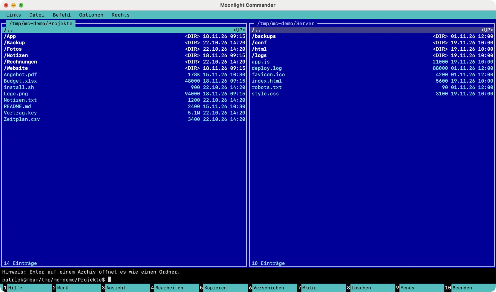

# Moonlight Commander

[English version](README.en.md)

Nativer Norton-Commander-Klon für macOS (AppKit). Zwei Panels, schnelle Dateioperationen, SFTP, FTP/FTPS und ein mcedit-artiger Editor.

[Download (DMG, signiert und notarisiert)](https://github.com/patrickdoern/mc/releases/latest) · [Webseite](https://moonlight-commander.org)



```bash
./scripts/bundle.sh
open "build/Moonlight Commander.app" --args ~/Downloads ~/projects
```

Bauen: `./scripts/build-libssh2.sh` baut OpenSSL und libssh2 einmalig statisch nach `vendor/` (nur Xcode und Netzwerk nötig). `./scripts/bundle.sh` erzeugt `build/Moonlight Commander.app`, `./scripts/install.sh` installiert sie nach `/Applications/Moonlight Commander.app`. Die App ist eine einzelne Datei ohne Homebrew, läuft ab macOS 14 auf Apple Silicon. Ohne `vendor/` greift `swift build` auf `brew install libssh2` zurück. Tests: `swift test`; mit der Umgebungsvariable `MC_SSH_CONFIG=<Datei>` liest die App SSH-Aliase, Schlüssel und `known_hosts` nur aus dieser Konfiguration statt aus `~/.ssh` (für gefahrlose Tests gegen lokale Server); die SFTP-Tests laufen nur mit `MC_TEST_SSH_DIR` (Ordner mit `clientkey`, sshd auf 127.0.0.1:2222).

## Kommandozeile

`./scripts/install.sh` legt `mc` und `mcedit` nach `~/.local/bin`; ihre Meldungen erscheinen in der Systemsprache (Deutsch oder Englisch):

```bash
mc                    # aktuellen Ordner im aktiven Panel öffnen
mc ordner1 ordner2    # linkes und rechtes Panel setzen
mcedit datei.txt      # Datei direkt im Editor öffnen (neue Dateien werden angelegt)
```

Beides funktioniert auch bei laufender App. Ordner lassen sich außerdem aufs Dock-Icon ziehen.

**Finder:** Textdateien lassen sich per Rechtsklick → „Öffnen mit“ → Moonlight Commander im Editor öffnen (die App ist nur als Alternative eingetragen und ersetzt keinen Standard). Über Info → „Öffnen mit“ lässt sie sich für einen Dateityp als Standard festlegen. Ordner, die man aufs Dock-Icon zieht, öffnen sich im aktiven Panel.

## Tasten

| Taste | Aktion |
|---|---|
| Tab | Panel wechseln |
| Enter / Backspace | öffnen / eine Ebene hoch |
| Leertaste, Einfg, ⇧↑↓ | markieren; `+` `-` Muster, `*` umkehren |
| Ctrl-S | Schnellsuche |
| ⌘L / ⇧⌘H / ⌘K | Pfad / Home / SFTP oder FTP verbinden |
| ⌘← / ⌘→ | Verzeichnisverlauf zurück / vorwärts (pro Panel, die Verlaufsliste steht im Menü Links/Rechts unter „Verlauf …“) |
| F2 | Benutzermenü (Einträge aus `~/.config/moonlight-commander/menu`, Format wie mc, Makros `%f %d %s %D %F`) |
| F3 / F4 | Anzeigen / Bearbeiten (⇧F4 neue Datei), beides mit Syntax-Highlighting |
| F5 / F6 | Kopieren / Verschieben (⇧F6 Umbenennen) |
| F7 / F8 | Ordner anlegen / Löschen (lokal Papierkorb, ⇧F8 endgültig) |
| F9 / F10 | Menüzeile (Links, Datei, Befehl, Optionen, Rechts) / Beenden; `exit` in der Kommandozeile beendet ebenfalls |
| Tippen | schreibt in die Kommandozeile; Tab vervollständigt Befehle und Dateinamen, Enter führt im Terminal aus (Ordner des aktiven Panels), `cd` wechselt das Panel |
| Ctrl-O | Terminal ein/aus (echte Shell, interaktive Programme wie `vim` und `top` laufen; beim Einblenden wechselt eine untätige Shell in den Ordner des aktiven Panels) |
| ⌘Y | Quick Look für die Datei unter dem Cursor |
| ⌘Enter | Dateiname unter dem Cursor in die Kommandozeile einfügen |
| Ctrl-P / Ctrl-N | Befehlsverlauf |
| ⌘R | Aktualisieren |

Beim Beenden merkt sich die App pro Panel Ordner, Sortierung, Listenformat und Ansicht (Liste, Schnellansicht, Info, Baum) sowie das aktive Panel und stellt sie beim nächsten Start wieder her.

Alle Aktionen stehen auch im Menü (⌥3 bis ⌥8). Editor: F2 Sichern, F3 Block markieren, F4 Ersetzen, F5/F6/F8 Block kopieren/verschieben/löschen, F7 Suchen, Ctrl-Y Zeile löschen, F10/Esc Ende.

SFTP: ⌘K (oder Menü Links/Rechts → SFTP-Verbindung), dann `user@host[:port][/pfad]` oder ein SSH-Alias. Zurück zum lokalen Dateisystem mit ⇧⌘H.

FTP: ebenfalls ⌘K, mit `ftp://[user@]host[:port][/pfad]` (Standard: TLS, wenn der Server es anbietet) oder `ftps://…` (implizites TLS, Port 990). Ohne Nutzer wird anonym angemeldet, Passwörter landen wie bei SFTP optional im Schlüsselbund. Dateien laufen über temporäre Dateien, Symlinks und Zeitstempel setzen gehen nicht. Der FTP-Test läuft nur mit `MC_TEST_FTP_PORT` (anonymer, schreibbarer Server auf 127.0.0.1).

Remote-Terminal: Ctrl-O auf einem SFTP-Panel öffnet eine ssh-Sitzung im Ordner des Panels (je Server eine eigene, das lokale Terminal bleibt daneben bestehen). Beim Passwort-Dialog lässt sich das Passwort im Schlüsselbund sichern (Befehl → Gespeicherte Passwörter zum Vergessen). Mit `MC_SIGN_IDENTITY="Apple Development: …" ./scripts/bundle.sh` signiert, fragt der Schlüsselbund nach einem Neubau nicht erneut.

## Weitere Funktionen

- **Masken:** Beim Kopieren, Verschieben und Umbenennen ist im Ziel eine Maske möglich, z. B. `*.bak` (foo.txt → foo.bak) oder `neu_*` (foo.txt → neu_foo.txt).
- **Archive als Ordner:** zip, tar, tar.gz/bz2/xz/zst, 7z, rar, iso und weitere öffnen mit Enter (schreibgeschützt, Kopieren nach außen und Ansehen gehen).
- **Panelisieren:** Suchergebnisse („Als Panel anzeigen“) oder die Ausgabe eines Befehls (Befehl → Externes Panelisieren) erscheinen als Panel, in dem man kopieren, ansehen und löschen kann.
- **Mehrspaltig:** Listenformat „Kurz“ zeigt 2 bis 3 Spalten.
- **Live-Aktualisierung:** Lokale Panels laden sich selbst neu, sobald sich ihr Verzeichnis von außen ändert; Cursor und Markierungen bleiben erhalten. Bei SFTP, FTP und Archiven bleibt ⌘R.
- **Hintergrund:** Lange Operationen lassen sich im Fortschrittsdialog in den Hintergrund schicken; Status rechts in der Kommandozeile, Abbrechen unter Befehl → Hintergrundaufgaben.
- **Dateizuordnung:** `~/.config/moonlight-commander/ext` legt pro Muster fest, was Enter (`open`), F3 (`view`) und F4 (`edit`) tun; Beispiele stehen in der Datei, nach „Befehl → Dateizuordnung bearbeiten“.
- **Viewer (F3):** F2 Zeilenumbruch, F4 Hex-Ansicht, F5 Gehe zu Zeile, F7 Suche (Regex möglich), F8 Codierung wählen, F9 Vorschau/Quelltext.
- **Markup-Vorschau:** Markdown (`.md`) und HTML (`.html`) erscheinen im Viewer formatiert (Überschriften, Listen, Zitate, Code, Tabellen, Links); F9 schaltet auf den Quelltext. Bei HTML werden Skripte, Stylesheets und Bilder nicht geladen (Bilder erscheinen als `[Bild]`).
- **Editor (F4):** Regex-Suche und -Ersetzen mit `$1`, Codierung wählen, Datei einfügen und Block sichern (Menü Bearbeiten).

## Menüzeile (F9, Pfeiltasten wechseln zwischen den Menüs, Enter wählt, Esc schließt)

- **Links/Rechts:** Dateiliste, Schnellansicht, Info, Baum, Listenformat, Sortierreihenfolge, Filter, SFTP/FTP, Pfad, Home-Ordner, Zurück, Vorwärts, Verlauf, Anordnen.
- **Datei:** Anzeigen, Bearbeiten, Kopieren, Chmod, Link, symbolischer Link (auch relativ, bearbeitbar), Chown, Umbenennen, Löschen, Gruppenauswahl.
- **Befehl:** Benutzermenü, Verzeichnisbaum, Datei suchen (Name und Inhalt), Verzeichnisse vergleichen (markiert Unterschiede und meldet die Anzahl), Dateien vergleichen (eingebauter Diff im Viewer, funktioniert ohne Xcode; der Cursor im anderen Panel darf auch nur der gleiche Dateiname sein) und optional in FileMerge, Verzeichnisgrößen, Befehlschronik, Chronik angesehener Dateien (die letzten 30 lokalen Dateien aus Viewer und Editor, die ersten neun mit Ziffern 1 bis 9 wieder öffnen), Hotlist (⌘D, die ersten neun Einträge springt man direkt mit den Ziffern 1 bis 9 an), aktive Verbindungen.
- **Optionen:** Konfiguration, Layout, Paneloptionen, Nachfragen, Aussehen (Norton Blau, Dunkel, Hell), Update-Prüfung: Die App fragt beim ersten Start, ob sie beim Start nach neuen Versionen suchen darf (höchstens einmal je 24 Stunden, bei GitHub, ohne persönliche Daten, nur ein Hinweis mit Link, kein Download); die Option „Beim Start nach Updates suchen“ ändert das, „Nach Updates suchen …“ prüft sofort.

Gegenüber dem Midnight Commander nicht enthalten: Shell-Verbindungen, Darstellungsbits, Tasten lernen, Virtuelles Dateisystem. Die Codierung lässt sich nur im Editor und Viewer wählen.

## Verteilen

```bash
MC_SIGN_IDENTITY="Developer ID Application: …" MC_NOTARY_PROFILE=<profil> ./scripts/dist.sh
```

Erzeugt ein signiertes, notarisiertes `build/mc.dmg` mit Verknüpfung auf „Programme“ zum Hineinziehen. Das Notary-Profil legst du einmal mit `xcrun notarytool store-credentials` an. Der Mac App Store ist wegen der Sandbox nicht möglich, siehe ADR-0003.

### Auf einen anderen Mac kopieren

`/Applications/Moonlight Commander.app` per `rsync`, `scp` oder USB-Stick kopieren, dann startet sie direkt. Kommt sie per AirDrop, Download oder Cloud, markiert macOS sie als Quarantäne, und Gatekeeper blockiert sie ohne Notarisierung. Dann einmal `xattr -dr com.apple.quarantine "/Applications/Moonlight Commander.app"` ausführen.

## Sprache

Die App zeigt ihre Oberfläche nach der macOS-Systemsprache auf Deutsch oder Englisch; ist weder Deutsch noch Englisch eingestellt, erscheint Englisch. Die Sprache lässt sich in der App wählen unter Optionen → Konfiguration → „Sprache:“ („Automatisch“ folgt der Systemsprache) oder pro App in den Systemeinstellungen unter Allgemein → Sprache & Region → Apps; die Änderung gilt nach einem Neustart der App, die App fragt in der App-Auswahl danach, ob sie sich gleich neu starten soll. Die Skripte `mc` und `mcedit` folgen immer der Systemsprache. Tastenkürzel und Befehle sind in beiden Sprachen gleich.

## Webseite

`website/` enthält die statische Seite für moonlight-commander.org (Start, Impressum, Datenschutz, Lizenzen), deutsch im Wurzelverzeichnis und englisch unter `/en/`, mit Sprachumschalter. Sie läuft auf GitHub Pages; `.github/workflows/pages.yml` veröffentlicht `website/` bei jeder Änderung auf `main`. Der Download-Button der Seite zeigt auf das neueste GitHub-Release. Ein neues Release: `dist.sh`, dann `gh release create vX.Y build/mc.dmg --generate-notes`.

## Fehler und Wünsche

Bitte als [Issue](https://github.com/patrickdoern/mc/issues/new/choose) melden, mit App- und macOS-Version und den Schritten zum Nachstellen.

## Entstehung

Der Code ist mit KI-gestützter Softwareentwicklung (Claude Code von Anthropic) entstanden und wurde von Patrick Dörn konzipiert, geprüft und getestet.

## Lizenz

MIT-Lizenz, siehe [LICENSE](LICENSE). Lizenzen der enthaltenen Drittsoftware stehen auf moonlight-commander.org/lizenzen.
